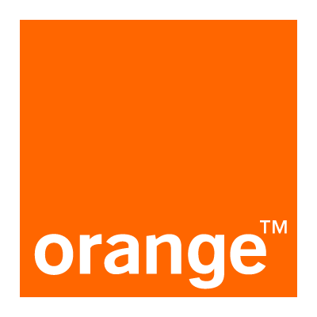

# JOTTALE — « Quand une opération bloque, tu sais quoi faire. »

Mini-app d'accompagnement à la résolution des incidents **Max it / Orange Money** — Prototype **Max It Week — Orange Digital Center Sénégal**.

> ⚠️ **Prototype de démonstration** : données 100% fictives, stockage local (`localStorage`) uniquement. Aucune vérification sur un compte réel. Aucun PIN/OTP/CNI collecté.



## Lancer le prototype

```bash
npm install
npm run dev      # http://localhost:5173
npm run build    # build prod (tsc + vite)
npm run preview  # preview du build
```

## Parcours démo jury (60 secondes)

1. **Accueil** → **Lancer la démonstration** (pré-remplit : transfert **10 000 FCFA**, chargement long, résultat **incertain**)
2. **Diagnostic guidé** (3 étapes : type/date/montant → résultat observé → résumé) → **Analyser**
3. **Analyse** : message *« Nous ne pouvons pas confirmer le résultat… Vérifiez l'historique »* + **Garde-fou** *« Avant de recommencer, vérifiez… »* (anti-doublon)
4. **Créer mon dossier** → référence locale `JOT-XX000` + timeline 5 étapes
5. **Copier / Partager** le résumé, faire évoluer le statut jusqu'à **Résolution simulée**
6. **Mes dossiers** persiste après refresh (`jottale_dossiers_v1`)

Scénarios secondaires : achat pass incertain, opération en échec signalé.

## Stack

**React 19 + TypeScript + Vite + lucide-react** — pas de backend, pas de dépendance lourde.

## Structure

```
src/
  App.tsx    # vues : home, diagnostic (3 steps), analyse, dossiers, détail
  types.ts   # View, DiagnosticData, Dossier, StatutDossier
  lib.ts     # persistance, genRef(), formatDate/FCFA, resumeText(), OrangeIntegrationPort
  index.css  # design system Orange (#ff7900) — mobile-first 390px, glass header, bottom nav
  main.tsx
logoorange.png / sonatellogo.jpeg  # fournis
```

## Design

- Mobile-first 390px, desktop centré 430px + fond radial Orange subtil
- Charte Orange mesurée : `#ff7900` en accent, blanc, `#0f0f0f`, gris clair
- Header glass + badge `PROTOTYPE`, bottom nav avec indicateur, hero avec radials
- Cartes avec accent latéral par statut, garde-fou ambre, timeline, pills, micro-animations

## Tests réellement exécutés

- `npm run build` → ✅ 5.6s, `267kB` (gz 81kB)
- `npm run dev` → ✅ `http://localhost:5173` répond 200
- Parcours 10 000 FCFA incertain → création dossier + persistance → ✅
- Garde-fou affiché uniquement si `incertain` → ✅
- Copie / partage (clipboard + Web Share fallback) → ✅
- Filtres + reset démo → ✅
- Responsive 390px + desktop → ✅

## Limites connues

- Aucune API Orange — tout est simulé et étiqueté `DÉMO`.
- Timeline dates = date du jour (démo).
- Partage = clipboard si Web Share indisponible.

## Intégration réelle dans Max it

Voir [`CONCEPT.md`](./CONCEPT.md) §6 + interface `OrangeIntegrationPort` dans `src/lib.ts` (aucun endpoint inventé).

## Audit — Est-ce un projet Top 1 ?

**Oui — Top 1 crédible**, à condition de pitcher le garde-fou + le parcours 10 000 FCFA en live. Voir `CONCEPT.md` pour l'argumentaire.

## Licence

Prototype pédagogique — ODC Sénégal / Max It Week.
